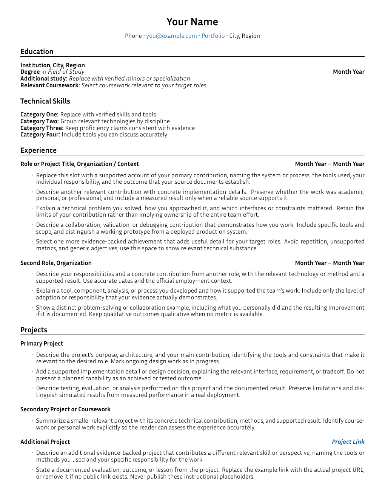

# Jobhunt Bot

A reusable, agent-guided job search pipeline: establish your career context and document style once, then use those files in later sessions to research jobs, rank matches, and create tailored LaTeX resumes and cover letters with checked PDFs.

This is a set of procedures and templates, plus a local PDF build helper. The agent performs research and writing; this repository is not an unattended scraper or application-submission service. No API key or paid integration is required by the repository itself. Your chosen assistant must provide the capabilities needed for the stages you run.

## Start here

1. Clone or download this repository to your computer. Keep your private working files under `private/` and run outputs under `outputs/`; both are excluded from Git.
2. Follow [desktop setup](docs/desktop-setup.md) for ChatGPT Desktop or Claude Desktop. Use either a folder-capable agent or the upload/download workflow. Ask the agent to read [AGENTS.md](AGENTS.md) explicitly.
3. Start the [initialization conversation](prompts/initialize.md). Supply your existing resumes and supporting documents. The agent interviews you, builds a factual evidence inventory, records your search requirements, and adapts the generic [resume template](templates/resume_template.tex) to your preferred style.
4. Review a rendered resume and cover-letter sample with the agent. Iterate until the content and style are right. Save the approved context, templates, and style rules under `private/`, following [initialization](docs/01-initialize.md).
5. Install local PDF tools using [the rendering guide](docs/05-render-and-verify.md). If your assistant cannot run commands on your computer, run the provided commands yourself and return the logs and previews for review.
6. In a new session, use [the campaign prompt](prompts/run-campaign.md). Load the saved context and specify a target count (10 is the default). The agent runs the stages below and saves a handoff for the next session.

## End-to-end workflow

| Stage | Procedure | Saved result |
| --- | --- | --- |
| Initialize and review sources | [01](docs/01-initialize.md) | Profile, search preferences, evidence, approved templates and style |
| Discover, filter, rank | [02](docs/02-discover-and-rank.md) | Ranked jobs workbook, research records, updated history |
| Research contacts | [03](docs/03-research-contacts.md) | Same job set with verified professional contacts/routing |
| Tailor documents | [04](docs/04-tailor-documents.md) | One resume and cover letter `.tex` per accepted job |
| Compile and inspect | [05](docs/05-render-and-verify.md) | Matching PDFs, logs, page previews, recorded visual review |
| Draft optional outreach | [06](docs/06-draft-outreach.md) | One unsent `.txt` draft per job |
| Reconcile and hand off | [07](docs/07-quality-and-handoff.md) | QA report, manifest, next-session instructions |

The ranked spreadsheet is the handoff between research and document generation. All later artifacts map to stable job keys, not changing row numbers. Unknown requirements stay explicit; a quota never justifies weak matches or invented experience.

## What you supply

Required: a resume or detailed factual career history, target role/location preferences, and enough project/work evidence to support application claims. Useful: multiple resume variants, existing LaTeX, cover-letter examples, portfolio links, writing samples, recommendations, and a previously considered jobs workbook. See the [input checklist](templates/input-checklist.md). Missing optional samples can be developed during setup.

The starter resume preserves the original format: Letter paper, 10-point Inria Sans, compact margins, Education / Technical Skills / Experience / Projects, and 14 bullet slots. Its placeholder text is instructional, not fictional experience. The initialization conversation replaces it with your facts and establishes your own density and section choices. Edit [style rules](templates/style-rules.md) in your private copy to change future runs without rewriting the pipeline.

Preview the generic [resume PDF](examples/resume-template.pdf) and [cover-letter PDF](examples/cover-letter-template.pdf). Both templates were compiled and visually checked; see [validation details](docs/repository-validation.md).

## Run selected stages

Use `source-review`, `jobs-only`, `contacts-only`, `resumes-only`, `cover-letters-only`, `emails-only`, or `render-and-verify` in [stage prompts](prompts/stage-prompts.md). `full` includes all stages, with outreach governed by saved preferences. Resume an interrupted run with [resume-session](prompts/resume-session.md); do not start a new history append for the same accepted jobs.

## Repository and private data

`docs/` contains procedures; `templates/` contains blank reusable context and LaTeX; `prompts/` contains copyable instructions; `scripts/` contains the renderer. `private/` holds personal context, sources, templates, and history. `outputs/<run-id>/` holds campaign results. Do not force-add ignored personal files when publishing this repository. Review `git status` and the staged diff before pushing.

The [source reconciliation](docs/source-reconciliation.md) explains which behavior came from the five source chats and local outputs, and which additions make the workflow portable. Public job postings change: historical examples were reviewed to reconstruct the process, not to recommend current openings.
